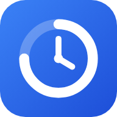
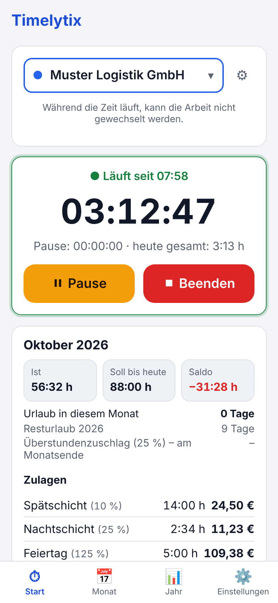
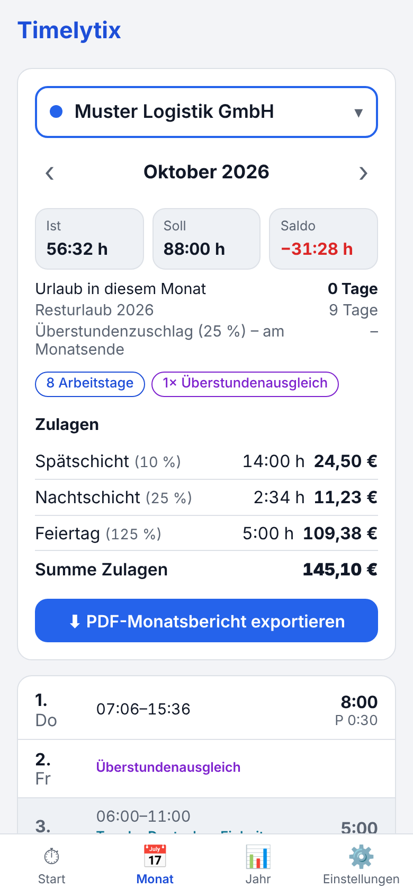
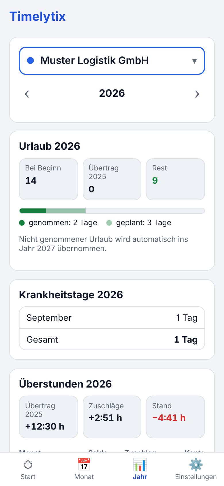
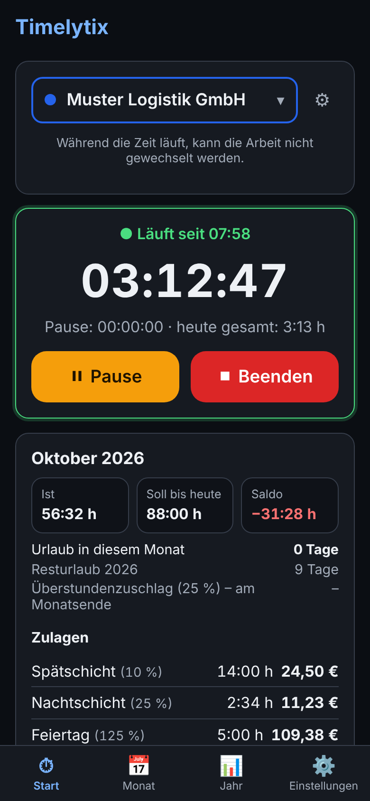
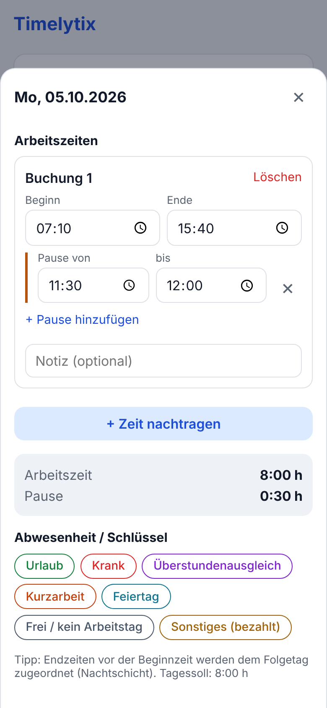
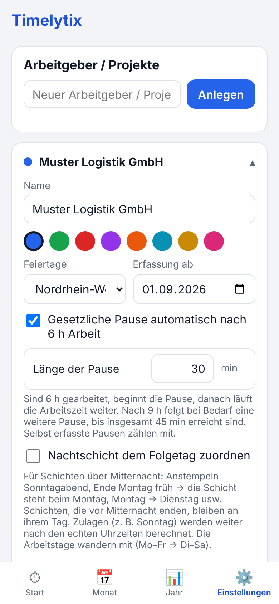
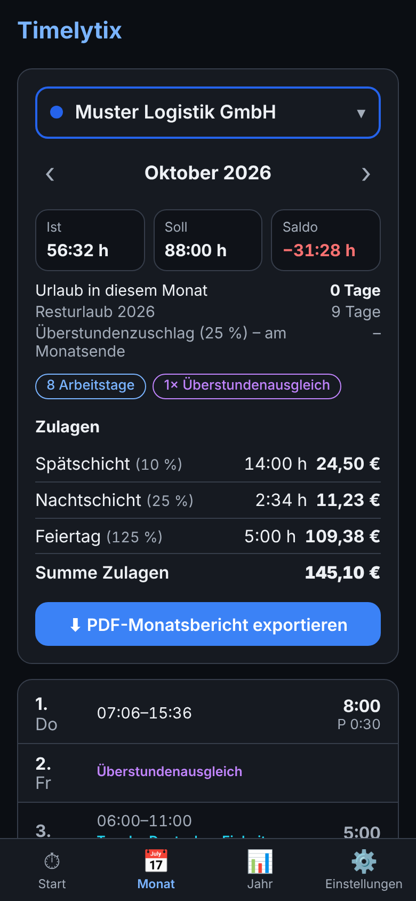

<p align="center">
  
</p>

<h1 align="center">Timelytix</h1>

<p align="center">
  <strong>Arbeitszeiterfassung für das Handy – einfach, offline und ohne Konto.</strong><br />
  Stempeln, Pausen, Überstunden, Urlaub, Zulagen und PDF-Monatsbericht. Alle Daten bleiben auf deinem Gerät.
</p>

<p align="center">
  <a href="https://theown91.github.io/Timelytix/android.html"><b>📲 Android-App herunterladen</b></a> ·
  <a href="https://theown91.github.io/Timelytix/"><b>🌐 Web-App öffnen</b></a> ·
  <a href="https://github.com/TheOwn91/Timelytix/releases"><b>📝 Versionen</b></a>
</p>

<p align="center">
  
  
  
  
</p>

---

## Inhalt

- [Das kann Timelytix](#das-kann-timelytix)
- [Installation](#installation)
- [Bilder](#bilder)
- [Abwesenheiten (Schlüssel)](#abwesenheiten-schlüssel)
- [Datenschutz & Datensicherung](#datenschutz--datensicherung)
- [Entwicklung](#entwicklung)

## Das kann Timelytix

### ⏱ Zeiterfassung
- **Start, Pause, Beenden** mit einem Tipp – die Uhr läuft weiter, auch wenn die App geschlossen ist
- **Mehrere Arbeitgeber oder Projekte** mit eigener Farbe, eigenem Lohn und eigenen Regeln
- **Zeiten nachtragen und korrigieren** im Tages-Editor, mehrere Buchungen pro Tag, Notizen
- **Nachtschichten** über Mitternacht; auf Wunsch zählt die Schicht zum Folgetag (Anstempeln Sonntagabend → steht beim Montag)
- **Fehlende Tage** auf einen Blick, mit Schnellauswahl für Urlaub, Krank, Überstundenausgleich, Kurzarbeit oder Frei

### ☕ Pausen
- **Gesetzliche Pause automatisch** (§ 4 ArbZG): nach 6 Stunden beginnt die Pause, nach 9 Stunden folgt bei Bedarf der Rest bis 45 Minuten – Länge einstellbar
- Selbst erfasste Pausen und kurze Lücken zwischen Buchungen zählen mit; lange Lücken (geteilter Dienst) gelten als Unterbrechung
- Automatische Pausen stehen danach als eigene Einträge in der Buchung und lassen sich ändern oder löschen

### 📊 Auswertung
- **Monatsansicht** mit Ist, Soll und Saldo, allen Tagen, Feiertagen und Abwesenheiten
- **Jahresübersicht** mit Urlaub (Anspruch, Übertrag, genommen, geplant, Rest), Krankheitstagen und Überstundenkonto Monat für Monat
- **Resturlaub und Überstunden** gehen automatisch ins nächste Jahr
- **PDF-Monatsbericht** mit Tagesliste, Zusammenfassung, Zulagen und Unterschriftsfeldern – zum Speichern oder Teilen
- Summen wahlweise als Stunden und Minuten (156:44 h) oder dezimal (156,73 h)

### 💶 Lohn & Zulagen
- **Zulagen minutengenau**: Uhrzeiten (auch über Mitternacht), Wochentage (z. B. Sonntag) und Feiertage – in Stunden und Euro
- Bei mehreren Zulagen zur selben Zeit zählt die höchste oder alle zusammen (einstellbar)
- **Zuschlag auf Überstunden**, gutgeschrieben am Monatsende
- **„Gültig ab“**: Stundenlohn, Sollzeit, Arbeitstage und Zuschläge ändern sich ab einem Datum – vergangene Monate bleiben unverändert
- **Gesetzliche Feiertage** aller Bundesländer, automatisch mit dem Tagessoll gutgeschrieben

### 📱 Android-App
- **Widget für den Startbildschirm**: Arbeitgeber wählen, laufende Zeit, Start, Pause und Beenden direkt vom Startbildschirm
- **Benachrichtigung „Zeit läuft“** mit Knöpfen für Pause/Weiter und Beenden
- **Erinnerungen**: samstags, wenn in der Woche Einträge fehlen, und wenn die Zeit ungewöhnlich lange läuft
- **Hell und dunkel**, passend zur Einstellung des Handys
- **Automatische Sicherung** in den Ordner „Dokumente/Timelytix“ – sie bleibt auch nach dem Deinstallieren erhalten
- Updates direkt aus der App, mit Übersicht, was neu ist

### 🔒 Ohne Konto, ohne Cloud
- Läuft **komplett offline**, alle Daten bleiben auf dem Gerät
- Datensicherung als Datei exportieren und wieder einlesen, z. B. beim Handywechsel
- Einrichtungs-Assistent beim ersten Start – in wenigen Schritten startklar

## Installation

### Android (empfohlen)

1. Auf dem Handy die **[Download-Seite](https://theown91.github.io/Timelytix/android.html)** öffnen und die APK herunterladen.
2. Die heruntergeladene Datei öffnen. Beim ersten Mal fragt Android, ob der Browser Apps installieren darf – **„Zulassen“** wählen und zurück zur Installation.
3. **„Installieren“** tippen – fertig. Timelytix erscheint wie jede andere App.
4. Beim ersten Start führt der Assistent durch die Einrichtung (Arbeitgeber, Arbeitszeit, Lohn, Startwerte). Danach einmal **Benachrichtigungen erlauben**, damit „Zeit läuft“ und die Erinnerungen erscheinen.

**Widget hinzufügen:** Startbildschirm lange gedrückt halten → *Widgets* → *Timelytix* → Widget an die gewünschte Stelle ziehen.

**Updates:** Die App sucht selbst nach neuen Versionen und zeigt „Update verfügbar“. Unter *Einstellungen → App-Version & Updates* geht das auch von Hand; dort lassen sich mit *Beta-Versionen testen* auch Testversionen vorab bekommen.

### iPhone und andere Geräte (Web-App)

1. Die **[Web-App](https://theown91.github.io/Timelytix/)** im Browser öffnen.
2. Auf den Startbildschirm legen:
   - **iPhone (Safari):** *Teilen* → *Zum Home-Bildschirm*
   - **Android (Chrome):** Menü ⋮ → *App installieren*
3. Ab jetzt über das Symbol starten – ein Internetzugang ist nicht mehr nötig.

Auf dem iPhone zeigt die installierte Web-App ab iOS 16.4 die Benachrichtigung „Zeit läuft“. Updates erscheinen als „Update verfügbar“ und werden erst nach „Jetzt installieren“ eingespielt.

> **Wichtig:** Die Web-App speichert im Browser. Werden die Website-Daten gelöscht, sind auch die Zeiten weg – deshalb regelmäßig unter *Einstellungen → Datensicherung* eine Sicherung exportieren.

### Von der Web-App zur Android-App wechseln

In der Web-App *Einstellungen → Datensicherung → Sicherung exportieren*, dann in der Android-App *Sicherung importieren*. Alle Zeiten, Arbeitgeber und Einstellungen sind übernommen.

## Bilder

<p align="center">
  
  
  
</p>
<p align="center">
  
  
  
</p>

<sub>Bilder mit Beispieldaten aus der Demo.</sub>

## Abwesenheiten (Schlüssel)

| Schlüssel | Wirkung |
|---|---|
| Urlaub, Krank, Feiertag, Sonstiges (bezahlt) | Das Tagessoll wird gutgeschrieben |
| Überstundenausgleich | Das Soll bleibt und wird vom Stundenkonto abgezogen |
| Kurzarbeit | Wird mit Überstunden verrechnet; das Stundenkonto geht dabei nie ins Minus |
| Frei / kein Arbeitstag | Der Tag hat kein Soll |

Urlaub am 24.12. und 31.12. zählt als halber Tag. Nicht benötigte Schlüssel lassen sich in den Einstellungen ausblenden.

## Datenschutz & Datensicherung

- Timelytix hat **kein Konto und keinen Server** – es werden keine Daten hochgeladen. Details in der [Datenschutzerklärung](https://theown91.github.io/Timelytix/datenschutz.html).
- **Automatische Sicherung** (einstellbar von täglich bis monatlich): in der Android-App unter „Dokumente/Timelytix“, in der Web-App im Download-Ordner.
- **Sicherung exportieren / importieren** jederzeit unter *Einstellungen → Datensicherung*.

## Entwicklung

React + TypeScript + Vite, als Android-App mit Capacitor.

```bash
npm install
npm run dev        # Entwicklungsserver
npm test           # Tests (Berechnungen, Feiertage, Zulagen …)
npm run build      # Web-App nach dist/
npm run build:demo # Demo mit Beispieldaten als einzelne HTML-Datei
```

- Die Web-App wird bei jedem Push auf `main` über GitHub Pages veröffentlicht (`.github/workflows/pages.yml`).
- Die Android-App baut der Workflow „Android-App bauen“; Anleitung, Signaturschlüssel und Play Store in [docs/android.md](docs/android.md).
- Neue Versionen und „Was ist neu?“ kommen aus [`src/lib/changelog.json`](src/lib/changelog.json).
